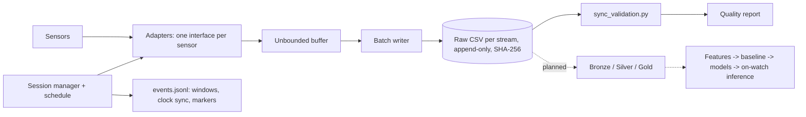

# WearLab-Watch8

**An open, validation-first research instrument for multimodal wearable sensing on the Samsung Galaxy Watch8.**

WearLab turns a consumer smartwatch into a data-acquisition platform that a researcher can defend: every sample is timestamped on two clocks, every stream is checksummed, every dropout is counted, and every dataset ships with an automatic synchronization/quality report. It records raw or low-level PPG, per-beat IBI, EDA, skin temperature, motion, barometer, light, GPS and device context on the watch itself, with configurable duty-cycled capture windows.

> Status: **v0.4 - acquisition layer complete and validated on hardware** (Galaxy Watch8 44 mm, SM-L330). Modelling, personalization and on-device inference are planned, not done. Nothing here is a medical device or makes clinical claims.

## Why this exists

Studies of attention, stress and mood with wearables (ADHD-related restlessness, anxiety/arousal, depression phenotyping) mostly rely on vendor-computed metrics (heart rate, "stress score", sleep stage). Those numbers are opaque, change between firmware versions and cannot be audited. The raw-signal route is open on the Watch8 through the Samsung Health Sensor SDK, but turning it into *trustworthy* data is its own problem: callbacks are batched, clocks differ between sensors, CPUs suspend with the screen off, and status flags are easy to discard.

The guiding principle, taken from the project's architecture document:

> **Measurement validity -> signal quality -> dataset quality -> model quality.** No modelling before the instrument is proven.

## Goals

1. A reproducible Wear OS logger: raw/low-level multimodal streams, session-based, crash-safe, versioned.
2. Quantified measurement validity: observed rate, jitter, gaps, clock drift and missingness reported per stream, per session, automatically.
3. A personal, longitudinal, quality-controlled multimodal dataset (physiology + motion + context + EMA/task labels).
4. A controlled attention/cognitive-workload study (Stroop/CPT) with synchronized task events.
5. Personal-baseline and personalized models, multimodal ablations, then on-watch inference and adaptive sensing.

## Research questions (planned; the instrument is the prerequisite)

- **RQ1** Does multimodal physiology + motion carry more information about attention/workload than HR/HRV alone?
- **RQ2** How much information does EDA add independently of PPG?
- **RQ3** How well do wrist-motion signatures relate to restlessness and task performance?
- **RQ4** Does a personal baseline improve feature stability?
- **RQ5** How much does a few minutes of personal calibration improve prediction?
- **RQ6** Can adaptive duty-cycling cut battery cost without a serious loss of information? *(the capture-window scheduler below is the substrate for this)*

## What is novel (and what is not)

Smartwatch sensing, EMA and HRV features are well-trodden. The contribution of this repository is the *engineering of trust* around a new sensor combination, to the best of my knowledge not available as an open, audited pipeline for the Watch8 generation:

| Contribution | Evidence in this repo |
|---|---|
| **Raw Watch8 multimodal logger incl. EDA, per-beat IBI and Samsung status codes under one clock model** (UTC + monotonic + session offset on every row) | `watch-app/`, CSV schema below |
| **Validation-first acquisition**: an automatic synchronization report (`analysis/preprocessing/sync_validation.py`) caught two *silent* data-loss modes that a normal logger would have shipped as clean data - a default 64-slot callback buffer dropping PPG bursts (203 sequence breaks in a 5-min session) and CPU suspend with the screen off costing ~15 % of ACC/GYRO samples. Both are fixed and the before/after numbers are recorded. | `reports/`, `docs/sensor-notes/2026-10-09_first-hardware-run.md` |
| **Context that explains artefacts**: off-body detector, battery temperature/charging/thermal state and per-sample quality flags. In a real test they showed the watch was on its charger - explaining EDA status -5 / HR status -3 - instead of the data being silently treated as valid. | `SystemAdapter`, `OFFBODY` stream |
| **Duty-cycled capture windows with exact-alarm wake-up** (e.g. 60 s every 10 min), per-window completeness events and window-aware statistics - infrastructure for the adaptive-sensing question (RQ6). | `SessionManager`, `events.jsonl` |
| **Silent-stall detection**: per-tracker watchdog + a controlled screen-on/off experiment that identified why wearable physiology streams go missing (display state, not code), with before/after numbers. | `docs/sensor-notes/` |
| **Dataset self-description**: manifest with SHA-256 per stream, chip/vendor/max-rate per sensor, app/firmware/Health Platform versions, full schedule. | `manifest.json`, `metadata.json` |

Not claimed: new algorithms, validated stress/attention detection, or medical accuracy. Those are the later phases.

## Sensors (18, all discovered at runtime - never hard-coded)

| Group | Streams | Source |
|---|---|---|
| Motion | accelerometer, gyroscope (up to 100 Hz), orientation (rotation vector), magnetometer | Android `SensorManager` |
| Environment / context | barometer, ambient light, **off-body**, step counter, battery/thermal/charging telemetry, **GPS** (opt-in, own file) | `SensorManager`, `LocationManager` |
| Physiology | PPG green/IR/red (25 Hz), HR + **one row per heartbeat (IBI)**, EDA (1 Hz), skin temperature (continuous 1/min and spot ~1/5 s) | Samsung Health Sensor SDK |
| Manual spot measurements | ECG (500 Hz), SpO2, multi-frequency BIA | Samsung Health Sensor SDK |

## Measured on hardware (Watch8, seated, 5 min)

| Stream | Observed / nominal rate | Gaps | Sequence breaks |
|---|---|---|---|
| ACC, GYRO | 49.95 / 50 Hz, dt jitter sd ~0.8 ms | 0 | 0 |
| PPG | 24.98 / 25 Hz | 0 | 0 |
| HR+IBI | 1.0 / 1 Hz | 0 | 0 |
| ECG (on-demand) | 500 Hz, lead-off flag valid | - | - |

**Important finding:** the Samsung HR/EDA/PPG trackers throttle to short bursts when the watch display is off (PPG 48-61 % missing, EDA 0.3 Hz). With the display kept on the same 5-minute session is complete (PPG 24.94 Hz, EDA 0.996 Hz, 0 stalls). The app has a *Keep screen on* option and a tracker watchdog that restarts stalled trackers and logs every stall (`tracker_silent` / `tracker_restart`). Details in `docs/sensor-notes/`.

Clock health over a session: UTC-minus-monotonic range ~1 ms, drift ~1 ms/h (30 sync points / 5 min). Periodic mode (3 x 30 s windows, 2 min apart): every window started within 58-151 ms of schedule with zero gaps. Full tables: [`reports/`](reports/).

## Architecture



**Transfer (Phase 4).** The watch offers a session (`OFFER`: file names, sizes, SHA-256); the phone asks only for files it lacks or that do not match (`WANT`), receives them over the Wearable Data Layer (gzip on the wire, ~5x faster over Bluetooth), recomputes every SHA-256 from the received bytes and only then replies `ACK`. The watch never deletes anything and marks a session `ACKNOWLEDGED` only after that ACK. `analysis/preprocessing/verify_transfer.py` repeats the check on the PC against the watch's own manifest. A mixed-version test showed a rejected (non-gzip) stream is refused instead of stored.

Principles (ADRs in [`docs/decisions/`](docs/decisions/)): raw data is immutable; UTC is canonical wall-clock and monotonic orders samples; capability-first (availability is read from the device); status flags are stored, never dropped.

## Repository layout

```
watch-app/        Wear OS app (Kotlin, Compose for Wear OS); packages: sensor/ session/ storage/ acquisition/ transfer/ ui/
phone-gateway/    Android phone app: receives and verifies sessions (same applicationId as the watch app, as the Data Layer requires)
common/           Shared transfer protocol (paths, JSON, SHA-256)
analysis/         Python tools (stdlib only): sync_validation.py, verify_transfer.py
reports/          Real synchronization reports from the test sessions
schemas/          JSON schema of the device capability report
docs/             architecture (Persian master document), ADRs, sensor notes
```

## Build and run

Requirements: JDK 17+, Android SDK 35, a Galaxy Watch8 with Developer options and Wi-Fi debugging.

1. **Samsung Health Sensor SDK (not redistributed - see its license).** Download v1.4.1 from <https://developer.samsung.com/health/sensor> and place `samsung-health-sensor-api-1.4.1.aar` in `watch-app/libs/`.
2. On the watch enable **Developer mode inside the *Health Platform* app** (tap its title ~10 times, then Developer mode -> On). Without it every Samsung tracker returns `SDK_POLICY_ERROR`.
3. Windows note: if the project path contains non-ASCII characters, build through an ASCII junction (the Android test JVM cannot resolve them).
4. `gradlew testDebugUnitTest assembleDebug`, then `adb install -r watch-app/build/outputs/apk/debug/watch-app-debug.apk`.
5. Record a session on the watch (Record -> START, or set a schedule). Install `phone-gateway` on the paired phone (`adb install phone-gateway/build/outputs/apk/debug/phone-gateway-debug.apk`), then on the watch: Sessions -> Send to phone. Pull on the PC: `adb pull /sdcard/Android/data/com.wearlab.watch/files/received` and run `python analysis/preprocessing/verify_transfer.py received`. (Direct alternative: `adb exec-out run-as com.wearlab.watch tar c files/sessions > sessions.tar`.)
6. Validate: `python analysis/preprocessing/sync_validation.py <session_dir> reports`

Per session: `manifest.json` (status, per-stream counts/checksums/gaps), `metadata.json` (device, firmware, schedule, sensor hardware), `events.jsonl` (window start/stop, clock sync, markers, errors) and one CSV per stream with columns `window, sequence, source_ts_ns, monotonic_ns, utc_ns, session_offset_ns, quality, <channels>`.

On-change sensors (off-body, steps): the first row of each window is the *current state*, timestamped when that state began (possibly before the window) - forward-fill it.

## Roadmap

| Phase | Content | State |
|---|---|---|
| 0-1 | Device validation, sensor inspector | done |
| 2 | Research logger, manifest, crash recovery | done |
| 3 | Time and synchronization validation | done |
| 3b | Duty-cycled windows, GPS, 18 sensors | done (GPS needs an outdoor test) |
| 4 | Phone gateway: checksum-verified Watch -> phone -> PC transfer | **done** (6/6 sessions verified end to end) |
| 5-6 | Bronze/Silver/Gold pipeline, signal-quality scores | planned |
| 7-10 | 7-day pilot, features, personal baseline, attention study | planned |
| 11-16 | Classical ML, multimodal ablation, personalization, TinyML, adaptive sensing | planned |

The full plan (modules, protocols, validation strategy, risk register) is in [`docs/architecture/`](docs/architecture/).

## Limitations and ethics

- Single device, single participant (pseudonymous ID `T001`) so far; no generalization is claimed.
- HR/IBI beat timestamps inside a one-second batch are estimated (the SDK gives one timestamp per batch).
- Magnetometer accuracy flags report uncalibrated; GPS needs a sky view and has not yet been tested outdoors.
- Raw physiological and location data from the author is **not** published here. If human participants are added: ethics approval, informed consent, retention and withdrawal policy come first.
- Not a medical device; no diagnosis.

## License

Code: MIT (see `LICENSE`). The Samsung Health Sensor SDK is subject to Samsung's own license and is not included.
