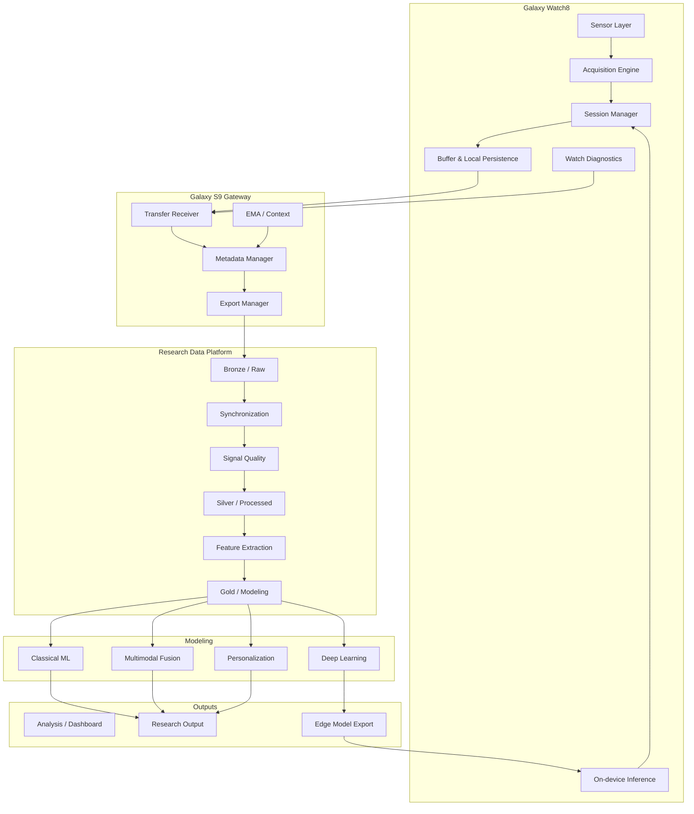

# Taha Galaxy Watch8 — Wearable AI Research Platform
## سند جامع معماری، ماژول‌ها، فازبندی، داده، تحلیل و مسیر پژوهشی

**نسخه:** 2.0  
**تاریخ:** 2026-10-05  
**وضعیت:** Active / Architecture & Implementation Planning  
**مالک پروژه:** Taha Mohammadi  
**دستگاه اصلی:** Samsung Galaxy Watch8 44mm (SM-L330)  
**Gateway فعلی:** Samsung Galaxy S9  
**هدف:** ساخت یک پلتفرم پژوهشی واقعی برای Wearable AI، Multimodal Sensing، Digital Phenotyping، HCI و Edge/TinyML

---

# 0. خلاصه اجرایی

این پروژه قرار نیست فقط یک اپ جمع‌آوری داده برای ساعت هوشمند باشد. هدف نهایی ساخت یک **زنجیره پژوهشی end-to-end** است که از سیگنال فیزیکی روی مچ شروع شود و به یک pipeline علمی، قابل‌تکرار و قابل‌دفاع برای پژوهش PhD برسد:

```text
Physical Sensor
    ↓
Raw Signal Acquisition
    ↓
Timestamping & Session Control
    ↓
Local Persistence
    ↓
Transfer / Export
    ↓
Synchronization
    ↓
Signal Quality Control
    ↓
Cleaned Multimodal Dataset
    ↓
Feature / Representation Extraction
    ↓
Personal Baseline
    ↓
ML / DL / Multimodal Fusion
    ↓
Personalized Models
    ↓
On-device / TinyML Inference
    ↓
Adaptive Sensing
    ↓
Research Output / Paper / PhD Evidence
```

اصل راهبردی پروژه:

> **Measurement validity → Signal quality → Dataset quality → Model quality**

یعنی تا وقتی مطمئن نشده‌ایم که سنسور را درست می‌خوانیم، timestampها معتبرند، داده ناقص یا artifactدار را می‌شناسیم و synchronization درست است، وارد مدل‌سازی پیچیده نمی‌شویم.

---

# 1. چشم‌انداز پروژه

## 1.1 چشم‌انداز کوتاه‌مدت

ساخت یک **Watch8 Research Instrument** که بتواند:

- سنسورهای قابل‌دسترسی را شناسایی کند.
- داده خام/low-level را بخواند.
- sessionهای کنترل‌شده ایجاد کند.
- timestamp دقیق ثبت کند.
- وضعیت کیفیت سیگنال و battery را ثبت کند.
- داده را در فرمت پژوهشی ذخیره کند.
- داده را به S9 و سپس PC منتقل کند.
- log فنی قابل‌بررسی ایجاد کند.

## 1.2 چشم‌انداز میان‌مدت

ساخت یک **multimodal personal dataset** شامل:

- physiology
- motion
- temperature
- context
- EMA
- task performance
- daily-life metadata

و سپس ایجاد pipeline پایدار برای:

- synchronization
- cleaning
- signal quality
- feature extraction
- personal baseline
- classical ML

## 1.3 چشم‌انداز بلندمدت

رسیدن به یک پلتفرم Wearable Intelligence با:

- multimodal fusion
- personalization
- uncertainty-aware prediction
- on-watch inference
- adaptive sensing
- intelligent duty cycling
- context-aware event detection

و تبدیل آن به:

- GitHub portfolio
- technical report
- reproducible methodology
- dataset methodology
- workshop/conference paper
- journal extension
- strong PhD research evidence

---

# 2. اهداف اصلی

## 2.1 اهداف مهندسی

1. توسعه اپ native روی Wear OS.
2. اتصال به sensor APIs رسمی/قابل‌دسترسی.
3. acquisition پایدار و قابل‌اندازه‌گیری.
4. session-based data logging.
5. timestamping و synchronization قابل‌اعتماد.
6. persistence امن روی watch.
7. انتقال به S9.
8. export قابل‌تحلیل.
9. logging و diagnostics.
10. آماده‌سازی برای inference روی watch.

## 2.2 اهداف داده‌ای

1. حفظ raw data بدون overwrite.
2. ساخت schema استاندارد.
3. versioning داده و preprocessing.
4. ثبت metadata کامل هر session.
5. جداکردن Raw / Processed / Feature datasets.
6. ساخت dataset قابل‌بازتولید.
7. جلوگیری از data leakage.
8. امکان longitudinal analysis.

## 2.3 اهداف علمی

1. بررسی reliability سنسورها در daily use.
2. تحلیل signal quality در شرایط واقعی.
3. ساخت personal physiological baseline.
4. بررسی multimodal fusion.
5. بررسی رابطه physiology + motion + context.
6. مطالعه attention/cognitive workload.
7. مطالعه restlessness/fidgeting.
8. مطالعه stress/arousal.
9. بررسی longitudinal digital phenotyping.
10. بررسی feasibility of Edge AI.

---

# 3. Scope پروژه

## 3.1 داخل Scope

- Galaxy Watch8 sensor acquisition
- Wear OS app
- Samsung Health Sensor Service / SDK investigation
- raw/low-level data access
- session management
- synchronized sensor recording
- S9 gateway
- data export
- signal processing
- signal quality
- feature engineering
- classical ML
- deep learning در صورت dataset کافی
- TinyML / on-device inference
- adaptive sensing
- EMA
- attention/cognitive tasks
- personal longitudinal dataset
- research documentation
- reproducibility

## 3.2 خارج از Scope فعلی

فعلاً این موارد اولویت ندارند:

- اتصال Watch8 به iPhone
- cloud architecture پیچیده
- dashboard production-grade
- multi-user SaaS
- medical diagnosis
- treatment recommendation
- clinical claim
- 24/7 raw capture همه سنسورها
- Transformer از روز اول
- multi-center human study
- production deployment برای کاربران عمومی

---

# 4. وضعیت فعلی سخت‌افزار

## 4.1 Galaxy Watch8

نقش:

> **Primary wearable research device**

مشخصات پروژه:

- Galaxy Watch8 44mm
- Model: SM-L330
- Region/SKU: MEA / Gulf
- Setup country: UAE
- Pairing با S9 انجام شده
- برخی consumer health features فعلاً region-restricted هستند
- research sensor layer باید مستقل validate شود

## 4.2 Galaxy S9

نقش:

> **Research Gateway / Companion / Transfer Device**

وظایف:

- host رسمی Watch8
- نصب/دیباگ اپ
- gateway
- دریافت فایل
- companion UI احتمالی
- EMA interface احتمالی
- transfer به PC
- diagnostics

## 4.3 PC

نقش:

> **Research Workstation**

وظایف:

- dataset archive
- preprocessing
- signal analysis
- feature extraction
- notebooks
- ML/DL
- experiments
- visualization
- paper figures
- reproducibility

---

# 5. معماری کلان سیستم



---

# 6. معماری ماژولار اپ Watch

اپ ساعت باید از ابتدا modular باشد.

پیشنهاد namespace:

```text
wearlab-watch/
├── app/
├── core/
│   ├── config/
│   ├── time/
│   ├── logging/
│   ├── permissions/
│   └── diagnostics/
├── sensor/
│   ├── api/
│   ├── capability/
│   ├── ppg/
│   ├── ecg/
│   ├── eda/
│   ├── accelerometer/
│   ├── gyroscope/
│   ├── temperature/
│   ├── hr_ibi/
│   ├── spo2/
│   └── bia/
├── session/
│   ├── domain/
│   ├── state/
│   ├── protocol/
│   └── controller/
├── acquisition/
│   ├── stream/
│   ├── buffer/
│   ├── scheduler/
│   └── backpressure/
├── storage/
│   ├── raw/
│   ├── metadata/
│   ├── manifest/
│   └── export/
├── transfer/
│   ├── protocol/
│   ├── queue/
│   └── retry/
├── quality/
│   ├── online/
│   └── indicators/
├── inference/
│   ├── model/
│   ├── runtime/
│   └── adaptive_sampling/
└── ui/
    ├── dashboard/
    ├── sensor_inspector/
    ├── session/
    ├── diagnostics/
    └── export/
```

---

# 7. تعریف ماژول‌ها

## M01 — Device Capability Module

### مسئولیت

تشخیص واقعی قابلیت‌های Watch8 خودمان.

### ورودی

- device
- OS
- SDK
- permissions
- Health Sensor Service state

### خروجی

```json
{
  "ppg": "AVAILABLE",
  "eda": "AVAILABLE",
  "ecg": "AVAILABLE",
  "accelerometer": "AVAILABLE",
  "temperature": "AVAILABLE"
}
```

### قابلیت‌ها

- enumerate trackers
- read API/version
- verify permission state
- verify developer mode state
- capability matrix
- diagnostic report

### Definition of Done

- هیچ sensor capability به‌صورت hardcoded فرض نشده باشد.
- وضعیت واقعی روی دستگاه خوانده شود.
- failure reason مشخص باشد.
- report قابل export باشد.

---

# 8. M02 — Sensor Adapter Layer

برای هر سنسور یک adapter مستقل.

Interface مفهومی:

```kotlin
interface SensorAdapter {
    val sensorType: SensorType
    suspend fun isAvailable(): Boolean
    suspend fun start(config: SensorConfig)
    suspend fun stop()
    fun samples(): Flow<SensorSample>
    fun status(): Flow<SensorStatus>
}
```

## هدف

لایه‌های بالاتر نباید به جزئیات API هر سنسور وابسته باشند.

مثلاً:

```text
PPG Adapter
EDA Adapter
ECG Adapter
ACC Adapter
Temp Adapter
```

همه باید interface مشترک بدهند.

---

# 9. M03 — Sensor Capability Inspector

اولین UI واقعی پروژه.

نمای اصلی:

```text
Watch8 Research Sensor Inspector

PPG        AVAILABLE
EDA        AVAILABLE
ECG        AVAILABLE
ACC        AVAILABLE
GYRO       AVAILABLE
TEMP       AVAILABLE
HR / IBI   AVAILABLE
BIA        AVAILABLE

SDK: ...
OS: ...
Firmware: ...
Developer Mode: ON

[Run Diagnostics]
```

برای هر سنسور:

```text
PPG

State: RUNNING
Requested mode: ...
Observed rate: ...
Samples: 24589
Dropped: 3
Timestamp jitter: ...
Battery: 81%
Duration: 00:13:21

[STOP]
```

---

# 10. M04 — Session Manager

هر collection باید session داشته باشد.

## State Machine

```text
IDLE
 ↓
CONFIGURED
 ↓
STARTING
 ↓
RUNNING
 ↓
STOPPING
 ↓
FINALIZING
 ↓
COMPLETED

Failure:
ANY_STATE → ERROR
```

## Session ID

پیشنهاد:

```text
T001_20261005_142230_BASELINE_001
```

## Session metadata

```json
{
  "participant_id": "T001",
  "session_id": "T001_20261005_142230_BASELINE_001",
  "protocol_id": "BASELINE_REST_V1",
  "watch_model": "SM-L330",
  "watch_os": "...",
  "firmware": "...",
  "research_app_version": "0.1.0",
  "sdk_version": "...",
  "region": "UAE",
  "start_utc": "...",
  "end_utc": "...",
  "battery_start": 82,
  "battery_end": 79
}
```

---

# 11. M05 — Acquisition Engine

این ماژول heart پروژه است.

## مسئولیت‌ها

- start/stop sensors
- دریافت concurrent streams
- sample normalization
- buffering
- sequence numbering
- overflow handling
- drop detection
- timestamps
- status events

## Event Model

هر sample:

```text
sample_id
session_id
sensor_type
channel
sequence_number
timestamp_device
timestamp_utc
timestamp_session_ms
value
quality_flag
```

---

# 12. M06 — Timestamp & Timebase Module

یکی از حساس‌ترین قسمت‌ها.

## سه زمان مهم

### 1. Device Monotonic Time

برای ترتیب واقعی sampleها.

### 2. UTC Timestamp

برای اتصال با:

- EMA
- task
- S9
- external events

### 3. Session-relative Time

مثلاً:

```text
t = 13245 ms
```

از شروع session.

## استاندارد داخلی پیشنهادی

```text
timestamp_utc_ns
timestamp_monotonic_ns
session_offset_ns
sequence_number
```

## چرا sequence_number؟

چون timestamp به‌تنهایی dropped sample را همیشه آشکار نمی‌کند.

---

# 13. M07 — Buffer & Backpressure

نباید فرض کنیم storage همیشه هم‌سرعت با sensor callbacks است.

Pipeline:

```text
Sensor Callback
    ↓
In-memory Ring Buffer
    ↓
Batch Writer
    ↓
Persistent Storage
```

## اهداف

- کم کردن IO
- جلوگیری از UI blocking
- drop detection
- fault tolerance
- batch flush

## پارامترهای configurable

```text
buffer_size
batch_size
flush_interval
max_queue_depth
overflow_policy
```

---

# 14. M08 — Local Storage

## اصل اصلی

> Raw sensor data immutable است.

ساختار local:

```text
sessions/
└── <session_id>/
    ├── manifest.json
    ├── metadata.json
    ├── ppg.bin
    ├── eda.bin
    ├── acc.bin
    ├── gyro.bin
    ├── temp.bin
    ├── events.jsonl
    └── diagnostics.json
```

برای نسخه اولیه می‌توان CSV/JSONL داشت، ولی معماری storage نباید به CSV وابسته شود.

---

# 15. M09 — Manifest

هر session باید manifest داشته باشد.

مثال:

```json
{
  "session_id": "...",
  "status": "COMPLETED",
  "streams": {
    "ppg": {
      "samples": 145220,
      "first_timestamp": "...",
      "last_timestamp": "...",
      "file": "ppg.bin"
    },
    "acc": {
      "samples": 143991,
      "file": "acc.bin"
    }
  },
  "errors": [],
  "export_status": "PENDING"
}
```

---

# 16. M10 — Diagnostics & Observability

از روز اول.

## Log levels

```text
DEBUG
INFO
WARN
ERROR
FATAL
```

## Eventهای مهم

- sensor_start
- sensor_stop
- permission_error
- callback_gap
- buffer_overflow
- file_flush
- transfer_start
- transfer_failure
- battery_low
- app_background
- service_restart

## Diagnostics report

باید برای هر session بتوانیم بفهمیم:

- چه شد؟
- چه چیزی قطع شد؟
- چند sample گم شد؟
- چرا؟
- باتری چقدر مصرف شد؟

---

# 17. M11 — Battery & Resource Monitor

در تمام sessionها:

```text
battery_start
battery_end
battery_delta
duration
estimated_drain_per_hour
thermal_state
storage_written_mb
```

در صورت امکان:

- CPU utilization estimate
- memory use
- wake lock duration

## معیار کلیدی

```text
Battery Cost per Sensor-hour
```

مثلاً:

```text
PPG + EDA + ACC
→ X % battery/hour
```

---

# 18. M12 — S9 Transfer Gateway

هدف:

```text
Watch8 → S9
```

نه مستقیماً cloud.

## وظایف S9

- discover pending sessions
- pull session
- verify checksum
- acknowledge transfer
- retry
- local archive
- export to PC

## حالت transfer

```text
PENDING
TRANSFERRING
VERIFIED
ACKNOWLEDGED
FAILED_RETRYABLE
FAILED_FINAL
```

---

# 19. M13 — Transfer Integrity

هر فایل:

```text
size
checksum
record_count
first_timestamp
last_timestamp
```

بعد از انتقال:

```text
source checksum == destination checksum
```

اگر verify نشد:

```text
DO NOT DELETE SOURCE
```

---

# 20. M14 — EMA / Context Module

این بخش ممکن است ابتدا روی S9 باشد.

## EMA

Scaleهای کوتاه 0 تا 10:

```text
focus
stress
anxiety
restlessness
fatigue
sleepiness
mood
perceived_workload
```

## Context

```text
activity
task
location_category
social_context
screen_state
time_of_day
recent_exercise
sleep_context
```

## اصل مهم

هیچ label بدون timestamp معتبر وارد dataset نشود.

---

# 21. M15 — Experiment / Task Module

برای آزمایش‌های کنترل‌شده.

مثال:

- Stroop
- CPT
- reaction-time task
- cognitive load task
- breathing / recovery task

## Event schema

```json
{
  "session_id": "...",
  "event_id": "...",
  "event_type": "STROOP_RESPONSE",
  "timestamp_utc": "...",
  "trial": 42,
  "correct": true,
  "reaction_time_ms": 681
}
```

---

# 22. Data Platform Architecture

## Bronze

Raw / immutable.

```text
data/
└── bronze/
    └── participant/
        └── date/
            └── session/
```

## Silver

Cleaned / synchronized.

```text
silver/
├── synchronized/
├── quality/
├── cleaned/
└── windows/
```

## Gold

Model-ready.

```text
gold/
├── physiological_features/
├── motion_features/
├── context_features/
├── labels/
└── multimodal/
```

---

# 23. Data Contracts

## 23.1 Common Sensor Record

```text
participant_id
device_id
session_id
sensor_type
channel
sequence_number
timestamp_utc
timestamp_monotonic
session_time_ms
value
quality_flag
app_version
firmware_version
```

## 23.2 ACC Record

```text
x
y
z
```

## 23.3 PPG Record

```text
channel
raw_value
```

## 23.4 EDA Record

```text
raw_value
contact_state
```

در صورت availability.

---

# 24. Synchronization Engine

وظیفه:

> تبدیل streamهای مستقل به timeline قابل‌تحلیل.

## مراحل

1. validate timestamp monotonicity
2. detect gaps
3. estimate actual sampling interval
4. map to common session clock
5. define target windows
6. resample فقط در Silver layer
7. preserve missingness
8. attach task/EMA events

## ممنوع

در Bronze:

- interpolation
- smoothing
- resampling
- artifact deletion

---

# 25. Signal Quality Architecture

## 25.1 Online QC

روی watch:

هدف فقط هشدار سریع.

مثلاً:

```text
PPG_CONTACT_POOR
EDA_FLATLINE
MOTION_HIGH
SENSOR_GAP
```

## 25.2 Offline QC

روی PC:

تحلیل کامل‌تر.

### PPG

- motion contamination
- clipping
- flatline
- implausible beat intervals
- missing samples
- abnormal waveform quality

### EDA

- contact loss
- saturation
- baseline drift
- movement contamination

### ACC

- clipping
- sensor freeze
- missing burst
- timestamp irregularity

### ECG

- poor contact
- noisy peaks
- short/invalid recording

---

# 26. Signal Quality Score

هر window:

```text
0.0 → unusable
1.0 → excellent
```

مثال:

```json
{
  "window_id": "...",
  "ppg_quality": 0.86,
  "eda_quality": 0.93,
  "motion_contamination": 0.14,
  "missing_ratio": 0.002,
  "usable": true
}
```

---

# 27. Windowing

واحد مدل باید مشخص باشد.

مثلاً:

```text
5 sec
10 sec
30 sec
60 sec
5 min
```

بسته به مسئله.

هر window:

```text
window_start
window_end
sensor_coverage
quality
label
context
```

---

# 28. Feature Engineering

## 28.1 PPG / HRV

مرحله اول:

- mean HR
- mean IBI
- SDNN
- RMSSD
- pNN50
- pulse amplitude
- pulse interval variability
- signal quality

مرحله دوم:

- nonlinear HRV
- morphology
- spectral features در صورت methodological validity

## 28.2 EDA

- SCL
- tonic mean
- tonic slope
- SCR count
- SCR amplitude
- rise time
- recovery
- phasic activity

## 28.3 Motion

- vector magnitude
- mean
- variance
- RMS
- SMA
- jerk
- energy
- dominant frequency
- entropy
- movement bursts
- stillness
- fidget features

## 28.4 Temperature

- mean
- slope
- deviation from baseline
- rolling z-score
- circadian deviation

---

# 29. Personal Baseline Engine

هدف:

> مقایسه فرد با baseline خودش، نه فقط population.

برای هر modality:

```text
current value
↓
context-matched baseline
↓
deviation
↓
personalized feature
```

Baseline ممکن است وابسته باشد به:

- hour-of-day
- activity state
- sleep state
- recent exercise
- weekday
- resting/non-resting

---

# 30. Context-aware Features

مثال:

```text
HRV_delta_from_personal_resting_baseline
EDA_delta_given_activity
temp_delta_same_time_of_day
movement_relative_to_study_period
```

این‌ها از raw absolute value ارزشمندترند.

---

# 31. Multimodal Fusion

## Level 1 — Early Fusion

```text
PPG features
+
EDA features
+
Motion features
+
Temperature features
+
Context
```

یک feature vector مشترک.

## Level 2 — Late Fusion

مدل مستقل برای هر modality و سپس ترکیب خروجی‌ها.

## Level 3 — Hybrid

نمایش جدا + fusion layer.

---

# 32. Ablation Study

برای هر study باید بفهمیم چه modality واقعاً ارزش دارد.

مقایسه:

```text
ACC only
PPG only
EDA only
Temp only

PPG + EDA
PPG + ACC
EDA + ACC
PPG + EDA + ACC
Physiology + Motion
Physiology + Motion + Context
Full Multimodal
```

---

# 33. مسیر ML

## Stage ML-0 — Sanity Baseline

- majority class
- naive baseline
- simple threshold

## Stage ML-1 — Classical

- Logistic Regression
- Random Forest
- XGBoost
- LightGBM
- SVM

## Stage ML-2 — Temporal Models

- 1D CNN
- TCN
- GRU
- LSTM

## Stage ML-3 — Advanced

- Transformer
- multimodal network
- representation learning

فقط اگر dataset توجیه کند.

---

# 34. Validation Strategy

## خطر اصلی

Windowهای یک فرد نباید تصادفی بین train/test پخش شوند و leakage ایجاد کنند.

## روش‌های معتبر

- temporal split
- subject-wise split
- leave-one-subject-out
- personalized calibration split

## metrics

بسته به task:

- Precision
- Recall
- F1
- AUROC
- AUPRC
- MAE
- RMSE
- calibration
- confusion matrix
- per-subject performance

---

# 35. Personalization

مقایسه سه مدل:

### Global

همه کاربران → یک مدل.

### Global + Calibration

مدل عمومی + چند sample از فرد.

### Personal

مدل فردی.

سؤال پژوهشی:

> calibration فردی چقدر performance را بهتر می‌کند؟

---

# 36. TinyML / On-device Inference

فقط بعد از تثبیت pipeline.

اولین مدل پیشنهادی:

## Model A — Signal Quality

```text
GOOD
BAD
```

بعد:

## Model B — Motion State

```text
STILL
LIGHT
HIGH
```

بعد:

## Model C — Physiological Arousal

```text
BASELINE
ELEVATED
```

بعداً:

- restlessness
- attention state
- workload

---

# 37. Adaptive Sensing

هدف:

```text
Information Value ↑
Battery Cost ↓
```

مثال:

```text
LOW-INTEREST STATE
    ↓
low-cost sensing
    ↓
event detector
    ↓
HIGH-INTEREST STATE
    ↓
increase sensing
    ↓
event resolved
    ↓
return to low-cost state
```

---

# 38. Adaptive Sensing Policy

مثال مفهومی:

```text
IF motion low
AND physiology stable
THEN lower sampling / fewer windows

IF EDA change high
OR HR deviation high
OR task active
THEN increase sensing
```

این policy باید بعداً empirical باشد، نه حدسی.

---

# 39. Protocol صفر — Sensor Validation

## هدف

اثبات اینکه acquisition واقعاً درست کار می‌کند.

## مراحل

### Test A — Rest

5 دقیقه نشسته.

### Test B — Wrist Motion

حرکت کنترل‌شده.

### Test C — Walking

5 دقیقه.

### Test D — Recovery

5 دقیقه نشسته.

### Test E — ECG Session

در صورت availability.

### خروجی

- observed rate
- gaps
- jitter
- motion artifact
- battery
- recoverability

---

# 40. Protocol یک — 7-Day Pilot

## هدف

اعتبارسنجی daily-life feasibility.

### Morning

- 2–5 min resting sensing
- EMA

### Midday

- کوتاه
- EMA
- context

### Evening

- resting sensing
- EMA

### طول روز

- daily metrics
- periodic windows

## خروجی

- missingness
- battery
- usability
- signal quality
- baseline variation
- adherence

---

# 41. Protocol دو — Attention Study

## ساختار

```text
Baseline Rest
    ↓
Stroop
    ↓
Recovery
    ↓
CPT
    ↓
Recovery
    ↓
EMA
```

## Data

- PPG
- EDA
- ACC
- Gyro
- Temperature
- task performance
- EMA

## labels

- reaction time
- correct/incorrect
- omission
- commission
- task phase
- trial difficulty

---

# 42. Research Questions

## RQ1

آیا multimodal physiology + motion اطلاعات بیشتری از HR/HRV تنها برای attention/workload می‌دهد؟

## RQ2

EDA چقدر information gain مستقل از PPG دارد؟

## RQ3

Motion signatures چقدر با restlessness و task performance مرتبط‌اند؟

## RQ4

personal baseline چقدر feature stability را بهتر می‌کند؟

## RQ5

personalized calibration چقدر prediction را بهتر می‌کند؟

## RQ6

آیا adaptive sensing می‌تواند battery cost را کاهش دهد بدون افت جدی information quality؟

---

# 43. Repository Structure

پیشنهاد:

```text
wearable-ai-watch8/
├── README.md
├── docs/
│   ├── architecture/
│   ├── protocols/
│   ├── decisions/
│   ├── sensor-notes/
│   └── experiments/
├── watch-app/
├── phone-gateway/
├── data-contracts/
├── analysis/
│   ├── notebooks/
│   ├── preprocessing/
│   ├── quality/
│   ├── features/
│   ├── models/
│   └── evaluation/
├── schemas/
├── configs/
├── tests/
├── scripts/
└── reports/
```

---

# 44. Architecture Decision Records

برای تصمیمات مهم ADR بسازیم.

مثلاً:

```text
ADR-001 Raw data is immutable
ADR-002 UTC is canonical wall-clock time
ADR-003 Bronze/Silver/Gold separation
ADR-004 S9 is initial gateway
ADR-005 ML begins only after signal-quality validation
ADR-006 No 24/7 raw collection by default
ADR-007 Personal baseline is first-class feature
```

---

# 45. Configuration-driven Design

هیچ protocol در code hardcode نشود.

مثال config:

```yaml
protocol_id: BASELINE_REST_V1
duration_sec: 300

sensors:
  ppg:
    enabled: true
  eda:
    enabled: true
  accelerometer:
    enabled: true
  temperature:
    enabled: true

metadata:
  activity: sitting
  posture: seated
```

---

# 46. Versioning Strategy

## App

Semantic version:

```text
0.1.0
0.2.0
1.0.0
```

## Dataset

```text
dataset-v0.1
dataset-v0.2
```

## Protocol

```text
BASELINE_REST_V1
BASELINE_REST_V2
```

## Features

```text
feature-set-v1
feature-set-v2
```

---

# 47. Reproducibility

برای هر experiment:

```text
commit_hash
dataset_version
protocol_version
feature_version
model_config
random_seed
environment
metrics
```

هدف:

> هر نتیجه باید قابل بازتولید باشد.

---

# 48. Privacy & Governance

حتی برای self-study:

- participant ID
- encryption
- raw immutability
- separate location data
- minimum necessary context
- audit trail
- controlled export

اگر participant انسانی اضافه شد:

- ethics approval
- consent
- retention policy
- withdrawal workflow
- pseudonymization
- access control

---

# 49. Security

## Watch

- حداقل permission لازم
- عدم ذخیره token حساس در plain text
- integrity metadata

## S9

- encrypted local storage در صورت امکان
- protected export directory

## PC

- encrypted research archive
- backup
- checksum

---

# 50. Testing Strategy

## Unit Tests

- timestamp conversion
- session state machine
- manifest creation
- checksum
- feature functions

## Integration Tests

- sensor → buffer
- buffer → storage
- storage → transfer
- transfer → PC

## Hardware Tests

- screen off
- background
- battery low
- reboot
- disconnect/reconnect
- long session
- storage pressure

---

# 51. Fault Injection

عمداً failure ایجاد کنیم:

- kill app
- disable Bluetooth
- fill storage
- low battery
- reboot watch
- disconnect phone
- stop sensor service

و ببینیم:

- data corrupt می‌شود؟
- session recover می‌شود؟
- manifest چه می‌گوید؟

---

# 52. Acceptance Criteria

## Sensor Layer

PASS اگر:

- start/stop قابل‌اعتماد
- no silent failure
- sample count ثبت شود
- errors قابل‌تشخیص باشند

## Storage

PASS اگر:

- raw محفوظ بماند
- crash → corruption گسترده ندهد
- manifest معتبر باشد

## Transfer

PASS اگر:

- checksum verify شود
- retry وجود داشته باشد
- source قبل از verify حذف نشود

## Analysis

PASS اگر:

- pipeline reproducible باشد
- output versioned باشد

---

# 53. فازبندی اجرایی

# Phase 0 — Environment & Device Validation
**Priority: P0 — Critical**

### Tasks

- [ ] ثبت OS/firmware/region
- [ ] Health Sensor Service status
- [ ] Developer Mode
- [ ] permissions
- [ ] SDK baseline
- [ ] capability enumeration
- [ ] اولین sample از هر sensor
- [ ] diagnostic report

### Deliverable

`Device Capability Report v1`

### Gate

بدون این مرحله P1 شروع نمی‌شود.

---

# Phase 1 — Sensor Inspector
**Priority: P0 — Critical**

### Tasks

- [ ] modular sensor adapters
- [ ] sensor status UI
- [ ] live sample count
- [ ] observed rate
- [ ] timestamp delta stats
- [ ] dropped-sample indication
- [ ] battery delta
- [ ] export diagnostics

### Deliverable

`WearLab Sensor Inspector v0.1`

---

# Phase 2 — Research Data Logger
**Priority: P0 — Critical**

### Tasks

- [ ] session manager
- [ ] protocol config
- [ ] local raw storage
- [ ] metadata
- [ ] manifest
- [ ] start/stop
- [ ] crash-safe finalize
- [ ] session list
- [ ] export

### Deliverable

`Watch8 Research Logger v0.1`

---

# Phase 3 — Time & Synchronization
**Priority: P0 — Critical**

### Tasks

- [ ] monotonic clock strategy
- [ ] UTC mapping
- [ ] sequence number
- [ ] gap detection
- [ ] session-relative time
- [ ] S9 event synchronization

### Deliverable

`Synchronization Validation Report`

---

# Phase 4 — S9 Gateway
**Priority: P1 — Very High**

### Tasks

- [ ] watch session discovery
- [ ] transfer protocol
- [ ] checksum
- [ ] retry
- [ ] local archive
- [ ] PC export

### Deliverable

`S9 Research Gateway v0.1`

---

# Phase 5 — Bronze/Silver/Gold Pipeline
**Priority: P1 — Very High**

### Tasks

- [ ] data contracts
- [ ] raw ingest
- [ ] parquet conversion
- [ ] metadata validation
- [ ] synchronized dataset
- [ ] feature dataset

### Deliverable

`Data Pipeline v0.1`

---

# Phase 6 — Signal Quality
**Priority: P1 — Very High**

### Tasks

- [ ] gap metrics
- [ ] missingness
- [ ] PPG quality
- [ ] EDA quality
- [ ] motion contamination
- [ ] QC score
- [ ] window usability flag

### Deliverable

`Signal Quality Pipeline v0.1`

---

# Phase 7 — 7-Day Pilot
**Priority: P1 — Very High**

### Tasks

- [ ] protocol
- [ ] EMA
- [ ] daily capture
- [ ] adherence
- [ ] battery
- [ ] missingness
- [ ] quality analysis

### Deliverable

`Pilot Dataset v0.1`

---

# Phase 8 — Feature Pipeline
**Priority: P1 — High**

### Tasks

- [ ] PPG/HRV features
- [ ] EDA features
- [ ] motion features
- [ ] temperature features
- [ ] context features
- [ ] feature manifest

### Deliverable

`Feature Set v1`

---

# Phase 9 — Personal Baseline
**Priority: P1 — High**

### Tasks

- [ ] baseline definitions
- [ ] time-of-day adjustment
- [ ] activity-conditioned baseline
- [ ] baseline deviation features
- [ ] visualization

### Deliverable

`Personal Baseline Engine v0.1`

---

# Phase 10 — Controlled Attention Study
**Priority: P1 — High**

### Tasks

- [ ] task software
- [ ] event synchronization
- [ ] Stroop/CPT protocol
- [ ] sensor collection
- [ ] task labels
- [ ] EMA
- [ ] QC

### Deliverable

`Attention Study Dataset v0.1`

---

# Phase 11 — Classical ML
**Priority: P2**

### Tasks

- [ ] sanity baseline
- [ ] logistic regression
- [ ] RF
- [ ] XGBoost/LightGBM
- [ ] subject-aware validation
- [ ] feature importance
- [ ] calibration

### Deliverable

`Baseline Modeling Report`

---

# Phase 12 — Multimodal Fusion & Ablation
**Priority: P2**

### Tasks

- [ ] unimodal models
- [ ] modality combinations
- [ ] ablation
- [ ] information gain
- [ ] performance vs complexity

### Deliverable

`Multimodal Ablation Report`

---

# Phase 13 — Personalized ML
**Priority: P2**

### Tasks

- [ ] global
- [ ] global + calibration
- [ ] personal
- [ ] temporal adaptation

### Deliverable

`Personalization Study`

---

# Phase 14 — Deep Learning
**Priority: P3**

شروع فقط اگر dataset توجیه کند.

---

# Phase 15 — TinyML
**Priority: P2/P3**

اول:

- signal quality
- motion state
- simple arousal

نه diagnosis.

---

# Phase 16 — Adaptive Sensing
**Priority: P3 — Research Contribution**

### هدف

کاهش battery cost با حفظ information quality.

---

# 54. Dependency Graph

```text
P0 Device Validation
   ↓
P1 Sensor Inspector
   ↓
P2 Logger
   ↓
P3 Time/Sync
   ↓
P4 Gateway
   ↓
P5 Data Pipeline
   ↓
P6 Signal Quality
   ↓
P7 Pilot
   ↓
P8 Features
   ↓
P9 Personal Baseline
   ↓
P10 Controlled Study
   ↓
P11 Classical ML
   ↓
P12 Multimodal
   ↓
P13 Personalized ML
   ↓
P14 Deep Learning
   ↓
P15 TinyML
   ↓
P16 Adaptive Sensing
```

---

# 55. اولویت نهایی

| رتبه | کار | اولویت |
|---:|---|---|
| 1 | Device/API Validation | Critical |
| 2 | Sensor Inspector | Critical |
| 3 | Research Logger | Critical |
| 4 | Timestamp/Sync | Critical |
| 5 | Raw Data Integrity | Critical |
| 6 | S9 Gateway | Very High |
| 7 | Signal Quality | Very High |
| 8 | 7-Day Pilot | Very High |
| 9 | Feature Pipeline | High |
| 10 | Personal Baseline | High |
| 11 | Attention Study | High |
| 12 | Classical ML | High |
| 13 | Multimodal Ablation | High |
| 14 | Personalized ML | High |
| 15 | Deep Learning | Medium |
| 16 | TinyML | Medium/High |
| 17 | Adaptive Sensing | Advanced |

---

# 56. Milestones

## Milestone A — Research Instrument

موفق وقتی:

- PPG/EDA/ACC و سنسورهای اصلی validated
- session logging
- timestamp
- raw storage
- manifest
- diagnostics
- battery measurement

## Milestone B — Reliable Dataset Pipeline

موفق وقتی:

- Watch → S9 → PC
- checksum
- Bronze/Silver/Gold
- synchronization
- QC

## Milestone C — Personal Pilot Dataset

موفق وقتی:

- حداقل چند روز usable data
- EMA
- context
- baseline
- quality report

## Milestone D — Controlled Study

موفق وقتی:

- task events synchronized
- multimodal clean data
- labels معتبر

## Milestone E — Modeling

موفق وقتی:

- baseline
- leakage-safe validation
- multimodal ablation
- reproducible results

## Milestone F — Edge Intelligence

موفق وقتی:

- small model روی watch
- measured latency
- measured battery
- adaptive sensing prototype

---

# 57. KPIهای فنی

نمونه KPI:

```text
sensor_start_success_rate
session_completion_rate
sample_gap_ratio
timestamp_jitter
transfer_success_rate
checksum_failure_rate
battery_drain_per_hour
usable_window_ratio
```

---

# 58. KPIهای داده

```text
missingness
coverage
quality_score
usable_minutes_per_day
EMA_completion_rate
sensor_overlap_ratio
```

---

# 59. KPIهای مدل

```text
F1
AUPRC
AUROC
calibration_error
per-subject_variance
personalization_gain
modality_gain
```

---

# 60. Risk Register

## R1 — Sensor API محدود

Mitigation:

- capability-first design
- no hard dependency before validation
- fallback modalities

## R2 — Battery drain

Mitigation:

- windowed collection
- adaptive sensing
- batch IO

## R3 — Background restrictions

Mitigation:

- long-session testing
- foreground/service strategy
- recovery logic

## R4 — Timestamp mismatch

Mitigation:

- monotonic + UTC
- sync events
- sequence numbers

## R5 — Poor signal quality

Mitigation:

- QC pipeline
- wear/contact protocol
- motion-aware analysis

## R6 — Small dataset

Mitigation:

- classical ML
- longitudinal data
- personal models
- avoid overparameterized DL

## R7 — Data leakage

Mitigation:

- temporal/subject-wise splits
- grouped CV

## R8 — Region limitations

Mitigation:

- separate consumer health and research sensor layer
- validate API access empirically

---

# 61. Research Integrity Principles

1. raw data دست‌نخورده بماند.
2. preprocessing versioned باشد.
3. missingness پنهان نشود.
4. artifactها ثبت شوند.
5. negative results ثبت شوند.
6. model selection بعد از validation plan انجام شود.
7. no cherry-picking.
8. claims از data قوی‌تر نباشند.
9. consumer health metrics با raw sensor data مخلوط نشوند.
10. پژوهش تشخیصی تلقی نشود.

---

# 62. مستندسازی PhD Evidence

هر فاز باید خروجی قابل‌نمایش داشته باشد.

## Engineering

- architecture diagram
- repo
- device integration
- data pipeline
- tests

## Research

- protocol
- hypotheses
- data dictionary
- QC methodology
- validation strategy

## ML

- baselines
- feature study
- ablation
- personalization
- uncertainty

## Edge AI

- model size
- latency
- battery
- adaptive sensing

---

# 63. پیشنهاد خروجی‌های Portfolio

## Project Page 1

**Galaxy Watch8 Multimodal Research Logger**

## Project Page 2

**Wearable Signal Quality & Synchronization Pipeline**

## Project Page 3

**Attention & Cognitive Workload Multimodal Study**

## Project Page 4

**Personalized Wearable AI**

## Project Page 5

**Adaptive On-device Sensing**

---

# 64. ترتیب اجرایی فوری

فعلاً فقط این sequence را اجرا می‌کنیم:

```text
1. Health Sensor Service Developer Mode
2. SDK project baseline
3. Capability enumeration
4. PPG test
5. EDA test
6. ACC test
7. Temperature test
8. ECG test
9. Timestamp validation
10. Battery measurement
11. Sensor Inspector
12. Session Logger
```

نه ML.

---

# 65. Definition of Done برای اولین Release

## WearLab v0.1

باید:

- سنسورها را discover کند.
- حداقل چند stream اصلی را بخواند.
- start/stop داشته باشد.
- session ID بسازد.
- timestamp ذخیره کند.
- raw file تولید کند.
- metadata تولید کند.
- battery delta ثبت کند.
- export کند.
- diagnostic log تولید کند.
- بعد از failure خاموش و silent نشود.

---

# 66. Definition of Done برای Dataset v0.1

- raw data immutable
- session manifest کامل
- synchronized timeline
- missingness annotated
- signal quality flags
- feature extraction reproducible
- metadata کامل
- protocol version ثبت‌شده
- قابل تحلیل از notebook

---

# 67. Definition of Done برای اولین Study

- protocol frozen
- task version frozen
- acquisition version frozen
- session QC
- label synchronization
- leakage-safe analysis
- statistical summary
- ML baselines
- multimodal ablation
- limitations documented

---

# 68. معیار تصمیم برای ورود به TinyML

فقط اگر:

- acquisition stable
- signal quality stable
- feature pipeline stable
- offline model reproducible
- model size قابل‌کاهش
- inference target واضح
- battery budget مشخص

باشد.

---

# 69. معیار تصمیم برای Paper

Paper باید حداقل یک contribution روشن داشته باشد.

مثلاً:

### Option A
Signal quality / synchronization contribution.

### Option B
Multimodal attention modeling.

### Option C
Personalized calibration.

### Option D
Adaptive sensing.

### Option E
Wearable dataset methodology.

فقط «استفاده از smartwatch برای classification» کافی نیست.

---

# 70. نتیجه

این پروژه باید از ابتدا به‌صورت **research infrastructure** ساخته شود، نه یک demo.

ساختار صحیح آن:

```text
Sensor
→ Acquisition
→ Session
→ Timestamp
→ Storage
→ Transfer
→ Dataset
→ Synchronization
→ Signal Quality
→ Feature
→ Baseline
→ Study
→ ML
→ Personalization
→ Edge AI
→ Adaptive Sensing
→ Research Output
```

اولین هدف واقعی ما:

> **ساخت Watch8 Research Instrument قابل‌اعتماد**

دومین هدف:

> **ساخت یک dataset شخصی multimodal و quality-controlled**

سومین هدف:

> **اجرای یک study کنترل‌شده درباره attention / cognitive workload**

چهارمین هدف:

> **ساخت و مقایسه مدل‌های multimodal و personalized**

و هدف نهایی:

> **اجرای بخشی از intelligence روی خود Watch8 و رسیدن به adaptive wearable sensing.**

---

# Appendix A — Current Status

## Completed

- [x] تعریف مسیر Wearable AI
- [x] بررسی ecosystemهای مختلف
- [x] انتخاب Galaxy Watch8
- [x] آماده‌سازی S9
- [x] تست ANCS روی Watch4 Classic
- [x] build و deployment پروژه ANCS
- [x] proof-of-concept notification bridge
- [x] خرید Watch8
- [x] setup Watch8
- [x] pairing Watch8 با S9

## Current Next Step

- [ ] Health Sensor Service Developer Mode
- [ ] sensor capability validation
- [ ] SDK baseline project
- [ ] first raw stream

---

# Appendix B — Naming Conventions

```text
participant: T001
session: S000001
protocol: BASELINE_REST_V1
dataset: DATASET_V0_1
feature_set: FS_V1
model: MODEL_ATTENTION_V1
```

---

# Appendix C — Minimal Data Dictionary

| Field | Meaning |
|---|---|
| participant_id | شناسه مستعار |
| session_id | شناسه session |
| sensor_type | نوع سنسور |
| channel | channel |
| timestamp_utc | زمان مرجع |
| timestamp_monotonic | ساعت monotonic |
| session_time_ms | زمان از شروع session |
| sequence_number | ترتیب sample |
| value | مقدار |
| quality_flag | وضعیت کیفیت |
| app_version | نسخه اپ |
| firmware_version | نسخه firmware |

---

# Appendix D — اولین سه خروجی قابل ارائه برای PhD

1. **Watch8 Research Logger**
2. **Multimodal Signal Quality & Dataset Pipeline**
3. **Attention / Cognitive Workload Multimodal Study**

این سه مورد باید قبل از رفتن به پروژه‌های گسترده‌تر به سطحی برسند که بتوان آن‌ها را در CV، وب‌سایت، GitHub و مکاتبه با supervisorها نشان داد.
